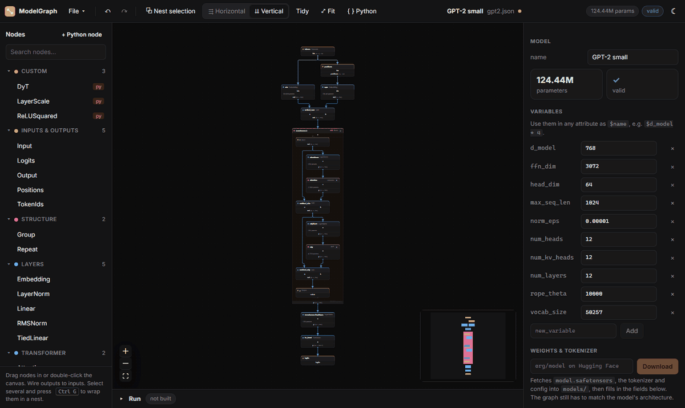
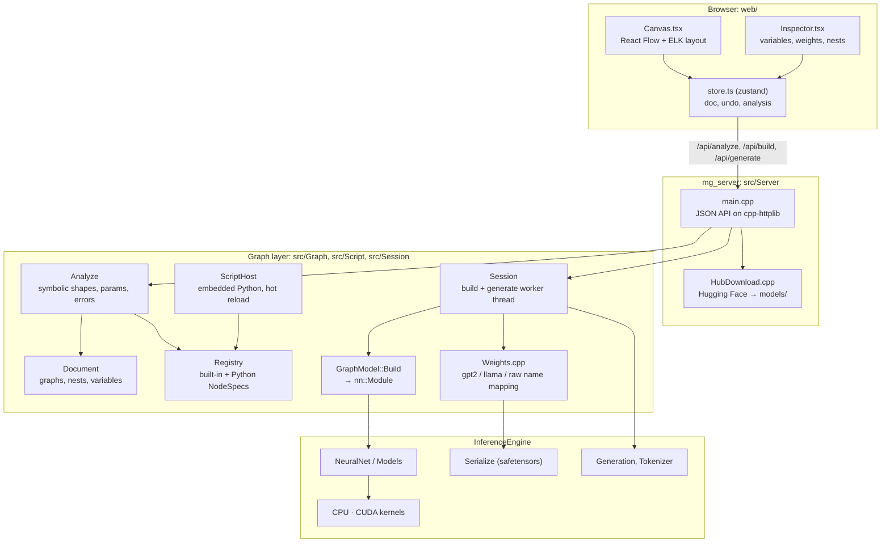
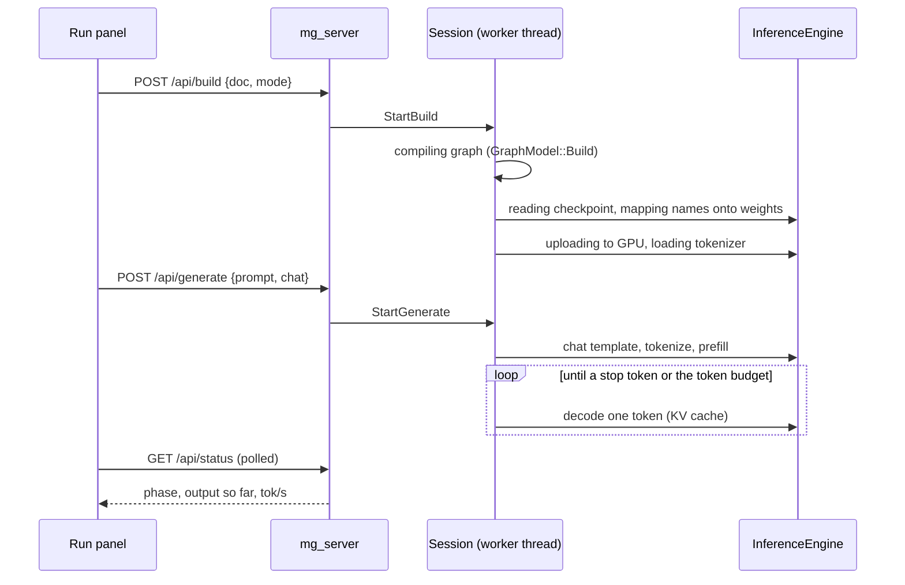

<div align="center">

# ModelGraph

**A visual editor for LLM architectures that runs what you draw: wire up primitives, check shapes live, and generate text with real GPT-2 and Llama weights on CPU or CUDA.**




<sub>The real editor running GPT-2 small (124.44M parameters). Zoom into a transformer block, open the attention nest, then set <code>d_model</code> to 1024: every port shape and the total (now 165.90M) update as you type. Recorded at real speed with <a href="tools/record_demo.py">tools/record_demo.py</a>.</sub>

</div>

- **Runs real checkpoints end to end:** GPT-2 small (124,439,808 parameters) and Llama 3.2 1B Instruct (1,235,814,400) load from `.safetensors` and generate text, with chat templates for instruct models.
- **Proven equivalent:** the graph versions of GPT-2-style, Llama-style and post-norm models produce the same logits as hand-written C++ reference models, with and without the KV cache. The Llama-style comparison also runs on CUDA.
- **Nothing is a black box:** attention is built from `Linear`, `SplitHeads`, `RoPE`, `KVCache` and `SDPA` nodes inside a nest you can open and rewire.
- **Extensible in Python, hot-reloaded:** a missing layer is one `.py` file. Saving it reloads the node, and a model that's already built picks up the new `forward()` on the next token.
- **24 GoogleTest tests**, all passing. GPT-2 generates at 20.97 tok/s on an RTX 4050 Laptop GPU.

## Highlights

**Shapes as symbols.** Shape inference runs on every edit and keeps dimensions symbolic (`[B,S,768]`), so a graph checks without a batch, and every node and nest shows its parameter count. Hyper-parameters are variables used as expressions (`$d_model * 4`). Errors are pinned to the node that causes them, not reported once for the whole graph.

**Nests compile to real modules.** Selecting nodes and pressing `Ctrl G` wraps them in a nest whose ports come from the links that cross its boundary. `Repeat ×N` copies a nest with separate weights per copy. Weight names fall out of the nest path: node `query` in nest `attention` in copy 3 of `transformer.h` owns `transformer.h.3.attention.query.weight`. That naming is what lets a stock checkpoint load onto a hand-drawn graph.

**Swap one layer, keep the rest pretrained.** "Rebuild, keep weights" recompiles after an edit and carries over every weight whose name and shape still match. You can replace one block of a pretrained model and test it without retraining the rest.

**Python nodes inside a C++ runtime.** `scripts/*.py` files are loaded by an embedded interpreter (pybind11). A node declares its ports, attributes, optional weights, optional shape function and `forward()`. The `ie` module exposes the engine's CPU/CUDA tensors, so a Python node runs on the same device as the rest of the graph.

**Weights from Hugging Face without a terminal.** Type a repo id in the inspector. The server downloads `model.safetensors`, the tokenizer and the config into `models/`, then fills in the checkpoint, name mapping, chat template and stop tokens. It uses WinHTTP, so there's no extra dependency, and it follows redirects itself so `HF_TOKEN` is only ever sent to huggingface.co.

## Architecture

All tensor maths, layers, tokenizers and checkpoint loading live in the separate [InferenceEngine](https://github.com/jazwinn/InferenceEngine) repository. ModelGraph is the graph layer and the editor on top: it turns a JSON graph into an `nn::Module` the engine can run.



One prompt, from the Run panel to streamed text:



| Path | Contents |
| --- | --- |
| `src/Graph/` | graph format, node registry, shape inference, compiler → `nn::Module`, checkpoint name mapping, templates |
| `src/Script/` | embedded Python: Python node specs, file watching, hot reload |
| `src/Session/` | build / load weights / generate on a worker thread |
| `src/Server/` | `mg_server`: JSON API, Hugging Face downloads, serves `web/dist` |
| `src/Cli/` | `mg_cli`: check, run and export graphs headlessly |
| `web/` | React + React Flow editor |
| `graphs/` | example models (`gpt2`, `llama3.2-1b`, `llama-3.2-1b-instruct`, `tiny`) |
| `scripts/` | Python node definitions (`DyT`, `LayerScale`, `ReLUSquared`) |
| `tools/` | `download_models.py`, `record_demo.py` |
| `tests/` | GoogleTest suite |
| `models/` | downloaded weights and tokenizers (git-ignored) |

## Performance

Measured on an **NVIDIA GeForce RTX 4050 Laptop GPU (6 GB)** with `mg_cli run graphs/gpt2.json --tokens 64 "The history of the transistor"`, greedy decoding:

| Model | Device | Load | Generation |
| --- | --- | --- | --- |
| GPT-2 small (124M) | CUDA | 2.52 s | 64 tokens in 3.13 s, **20.97 tok/s** |
| GPT-2 small (124M) | CPU | 1.73 s | 64 tokens in 82.70 s, 0.84 tok/s |

CPU and CUDA produced the same 64 tokens. Llama 3.2 1B Instruct also runs in chat mode on CUDA. Its speed isn't listed because the only measurement so far was taken while another process held most of the GPU's memory.

**Current bottleneck:** the CPU path is about 25× slower than CUDA on the same graph, so use CUDA for anything beyond the `tiny` model. Weights are float32, so a 1B model needs about 5 GB, which is close to the limit of a 6 GB GPU.

## Correctness and testing

```powershell
ctest --test-dir build -C Release --output-on-failure
```

| Suite | Tests | What it checks |
| --- | --- | --- |
| `Equivalence` | 5 | GPT-2-style, Llama-style and post-norm (untied head) graphs, with nested, fully decomposed attention and MLP, match InferenceEngine's hand-written `CausalModel` logits with and without the KV cache; the Llama graph again on CUDA; decomposed attention matches the fused node |
| `Analyze` | 5 | GPT-2 and Llama template shapes and parameter counts, shape mismatches reported on the offending node, cycles and missing inputs, symbolic reshapes |
| `Script` | 5 | Python nodes: loading, hot-reloading `forward()`, parameters and attribute expressions, shape errors, numpy interop, multiple outputs, the starter script |
| `Document` | 4 | JSON round trip, link replacement, unique names, variables that reference each other |
| `Expr` | 3 | expression arithmetic, errors, shapes mixing symbols and expressions |
| `Nests` | 2 | nest ports come from the subgraph; `Repeat` carries output 0 and broadcasts other inputs |

## Getting started (Windows)

Requirements: Visual Studio 2026 (or 2022), CMake ≥ 3.24, vcpkg at `C:\vcpkg`, CUDA 13 (for the CUDA build), Python ≥ 3.9 with development files (the python.org installer includes them), and Node.js ≥ 18. You do **not** need the InferenceEngine source: the build downloads its latest release (see below).

```powershell
# 1. Native side: engine, graph compiler, server, tests
cmake --preset default -DPython_EXECUTABLE="$env:LOCALAPPDATA\Programs\Python\Python313\python.exe"
cmake --build build --config Release

# 2. Web UI
cd web; npm install; npm run build; cd ..

# 3. Model weights (optional: the "tiny" model runs on random weights)
python tools\download_models.py gpt2                   # ~550 MB
python tools\download_models.py llama3.2-1b-instruct   # ~2.5 GB

# 4. Run: opens http://127.0.0.1:8710 in your browser
build\src\Release\mg_server.exe
```

Weights and tokenizers go into `models/`, which is git-ignored. The example graphs in `graphs/` point there (`../models/gpt2/model.safetensors`, ...). The script downloads from Hugging Face ([openai-community/gpt2](https://huggingface.co/openai-community/gpt2), and [unsloth/Llama-3.2-1B-Instruct](https://huggingface.co/unsloth/Llama-3.2-1B-Instruct), an ungated copy of Meta's model under the Llama 3.2 Community License). Set `HF_TOKEN` for models that need a login.

You can also download from the editor: select nothing (so the inspector shows the document), type a repo such as `HuggingFaceTB/SmolLM2-135M-Instruct` under **Weights & tokenizer** and press **Download**. The server fetches `model.safetensors`, `tokenizer.json`, `tokenizer_config.json` and the config files into `models/<name>/`, then fills in the checkpoint, name mapping, tokenizer, chat template and stop tokens. For gated repos, set `HF_TOKEN` before starting `mg_server`.

Use the `cpu` preset (`cmake --preset cpu`) to build without CUDA. Pick the Python to embed with `-DPython_EXECUTABLE=...`. Mixing two Python installs (for example a conda Python on `PATH`) is not supported; the build copies the right `python3xx.dll` next to each executable.

For UI development, run `npm run dev` in `web/` (Vite on port 5173 proxies `/api` to a running `mg_server`).

`mg_cli` covers the same pipeline without the UI:

```powershell
build\src\Release\mg_cli.exe check graphs\gpt2.json
build\src\Release\mg_cli.exe run graphs\llama3.2-1b.json --chat --tokens 64 "What is attention?"
build\src\Release\mg_cli.exe template tiny graphs\my-model.json
```

<details>
<summary><b>Where InferenceEngine comes from</b></summary>

By default the build uses the latest [InferenceEngine release](https://github.com/jazwinn/InferenceEngine/releases): the CPU or CUDA package (matching `IE_ENABLE_CUDA`) is downloaded into `build/_deps/`. Before every build it checks GitHub again and installs a newer release if one exists. Offline, the installed copy keeps working.

| Option | Effect |
| --- | --- |
| *(default)* | latest release, re-checked on every build |
| `-DIE_VERSION=v0.1.0` | stay on one release |
| `-DIE_SOURCE_DIR=../InferenceEngine` (or `cmake --preset dev`) | build the engine from a local checkout, for working on both repos |

If GitHub rate-limits the release check (60 requests per hour without a login), set a `GITHUB_TOKEN` environment variable.

</details>

<details>
<summary><b>Using the editor</b></summary>

| Action | How |
| --- | --- |
| Add a node | Drag from the palette, double-click the canvas, or press `/` |
| Add into a nest | Drop or double-click inside an expanded box |
| Connect | Drag from an output (right) to an input (left); drop on empty canvas to add a connected node |
| Nest / unwrap | Select nodes, then `Ctrl G`; right-click a nest and choose **Unwrap** |
| Repeat a block | Select a nest, then **Repeat ×N** in the inspector |
| Expand / collapse | The `+`/`−` button on a nest, or double-click it |
| Delete | `Del` / `Backspace` |
| Undo / redo / save | `Ctrl Z` / `Ctrl Y` / `Ctrl S` |
| Horizontal / vertical | The **Horizontal / Vertical** toggle in the top bar re-arranges every graph; the choice is saved with the graph |
| Tidy layout, fit | **Tidy** in the top bar (ELK layered layout: edges are routed around nodes, not through them); `F` to fit |

Weight names come from node names along the nest path, as described under Highlights. The `gpt2` and `llama` name mappings reuse InferenceEngine's converters; `raw` plus rename rules covers other checkpoints.

</details>

<details>
<summary><b>Writing a Python node</b></summary>

```python
import ie

name = "DyT"                       # node type shown in the palette
inputs = ["x"]
outputs = ["y"]
attrs = {"dim": "$d_model"}        # bool / int / float / str; "$..." are expressions

def params(a):                     # optional learned weights (loaded from checkpoints too)
    return {"weight": {"shape": [a.dim], "init": "ones"}}

def shape(a, x):                   # optional: output shape from input shapes
    return x

def forward(ctx, x):               # ctx.attrs, ctx.params, ctx.start_pos, ctx.device
    return ie.tanh(x) * ctx.params.weight
```

`ie` exposes InferenceEngine tensors (CPU or CUDA): arithmetic and `@`, `reshape`, `transpose`, `mean`, `ie.linear`, `ie.matmul`, `ie.softmax`, activations, `ie.sdpa`, `ie.split_heads`, `ie.merge_heads`, `x.numpy()` and `ie.tensor(array)`. `ie.exp`, `ie.log`, `ie.pow` and `ie.map` fall back to the CPU, so they are for prototyping. Examples are in [scripts/](scripts).

</details>

## Known limitations

- **Windows only for now.** The build presets target Visual Studio, and the in-editor Hugging Face download uses WinHTTP (other platforms get an error pointing at `tools/download_models.py`).
- **Single-file checkpoints.** Only one `model.safetensors` is loaded; repos that shard weights across several files are rejected with a clear error.
- **The graph must match the checkpoint.** Downloading weights fills in paths, not architecture; names that differ need the `gpt2`/`llama` mapping or rename rules.
- **float32 weights**, so memory is about 4 bytes per parameter.
- Python helpers `ie.exp`, `ie.log`, `ie.pow` and `ie.map` run on the CPU.

## Re-recording the demo

```powershell
pip install playwright pillow
build\src\Release\mg_server.exe --port 8711 --no-browser
python tools\record_demo.py docs\assets\editor.gif
```

The script drives your installed Microsoft Edge with Playwright against a separate server, so it doesn't touch a session you have open.
